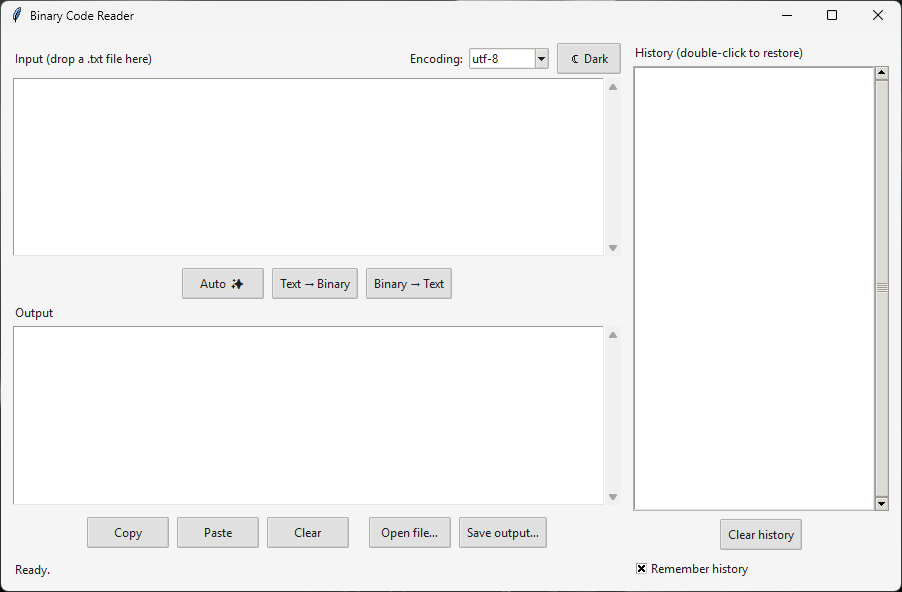
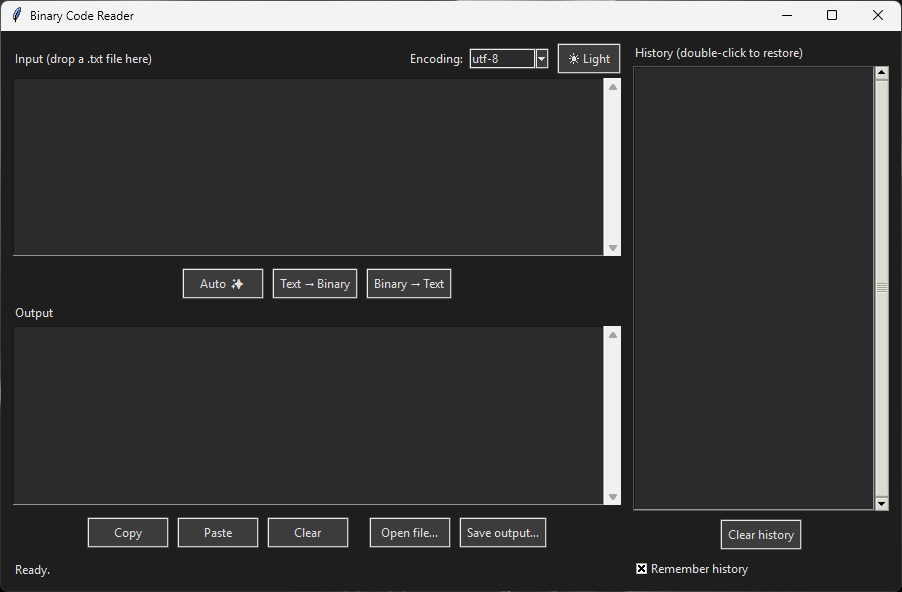

# Binary Code Reader

A small desktop tool that converts **text to binary** and **binary back to text**, with full UTF-8 support (Persian, emoji and more), selectable encodings, drag & drop, history and a dark mode.




## Features

- **Text → Binary** and **Binary → Text**, shown as 8-bit groups (`01001000 01100101`)
- **Auto-detect** button that picks the direction for you
- **Encodings:** UTF-8 (default), UTF-16 LE/BE, ASCII, Latin-1 and Windows-1256
- **Clear error messages** for invalid input instead of crashes
- **Open / Save** text files, and **drag & drop** a `.txt` file onto the input box
- **History** of the last 50 conversions (double-click to restore)
- **Dark mode**
- **Remembers** your theme, encoding and history between sessions
- Core logic is independent of the GUI and covered by automated tests

## Installation

### Option A: Download the app (Windows)

1. Download `BinaryCodeReader.exe` from the [Releases](../../releases) page.
2. Double-click it. No Python needed.

> **Note:** The executable is not code-signed, so Windows SmartScreen may show an "Unknown publisher" warning. Choose **More info → Run anyway** if you trust the download. You can also build it yourself (see [Building the executable](#building-the-executable)).

### Option B: Run from source

Requires **Python 3.10 or newer**.

```powershell
git clone https://github.com/<your-username>/BinaryCodeReader.git
cd BinaryCodeReader

python -m venv .venv
.venv\Scripts\Activate.ps1

pip install -r requirements.txt
python main.py
```

On Linux you may also need Tkinter: `sudo apt install python3-tk`. The app has only been tested on Windows.

## Usage

1. Type or paste text into **Input**.
2. Click **Text → Binary**, **Binary → Text**, or **Auto ✨**.
3. The result appears in **Output**. Use **Copy** or **Save output…** to keep it.

### Examples

| Input | Direction | Output |
|---|---|---|
| `Hello` | Text → Binary | `01001000 01100101 01101100 01101100 01101111` |
| `01001000 01101001` | Binary → Text | `Hi` |
| `س` | Text → Binary (UTF-8) | `11011000 10110011` |

Binary input may contain spaces, tabs or newlines, or none at all: `0100100001101001` works too.

### Auto-detect

Input is treated as binary only if, after removing whitespace, it contains **only `0` and `1`** and its length is a **multiple of 8**. Everything else is treated as text.

This is a heuristic. A text that looks like binary (for example `01000001`) is read as binary. Use the two manual buttons when you need to override it.

### Encodings

Binary has no meaning without an encoding: the same text produces different bytes in different encodings.

| Encoding | Notes |
|---|---|
| `utf-8` | Default. Persian letters use 2 bytes, emoji 4 bytes. |
| `utf-16-le`, `utf-16-be` | 2 bytes per basic character. No BOM is added. |
| `ascii` | English only. Other characters produce an error. |
| `latin-1` | 1 byte per character, never fails to decode. |
| `cp1256` | Windows Arabic/Persian code page, 1 byte per letter. |

Converting with one encoding and decoding with another gives wrong text, sometimes **without any error**. Always use the same encoding in both directions.

### Files

- **Open file…** or drag & drop loads a `.txt` file into the input box. Files are read using the selected encoding.
- Maximum file size is **200 KB**.
- Windows line endings (`\r\n`) are normalized to `\n`, and a UTF-8 BOM is removed.
- **Save output…** always writes UTF-8.
- Drag & drop needs the `tkinterdnd2` package. Without it the app still works, only drag & drop is disabled.

### History and settings

- History keeps the last 50 successful conversions and skips consecutive duplicates. Inputs longer than 10,000 characters are not stored.
- History is stored **as plain text** on disk. Untick **Remember history** to turn this off (the saved file is deleted immediately).
- Files are stored in `%APPDATA%\BinaryCodeReader`:

| File | Content |
|---|---|
| `settings.json` | Theme, encoding, history on/off |
| `history.json` | Saved history |
| `error.log` | Details of unexpected errors |

A missing or corrupted file never crashes the app; it falls back to defaults.

## Project structure

```text
BinaryCodeReader/
├── main.py              # Entry point
├── converter.py         # Core logic: text <-> binary, auto-detect, encodings
├── files.py             # Reading and writing text files
├── history.py           # Conversion history (with save/load)
├── settings.py          # Loading and validating user settings
├── storage.py           # Safe JSON read/write helpers
├── errorlog.py          # Error logging (needed because the .exe has no console)
├── gui.py               # Tkinter interface (display and input only)
├── tests/               # Automated tests
├── requirements.txt     # Runtime dependencies
└── requirements-dev.txt # Build tools
```

The GUI contains no conversion logic. Everything testable lives in modules that know nothing about Tkinter.

## Development

Run the tests (from the project root):

```powershell
python -m unittest -v
```

### Building the executable

```powershell
pip install -r requirements-dev.txt
pyinstaller --noconfirm --clean --windowed --onefile --name BinaryCodeReader --collect-all tkinterdnd2 main.py
```

The result is `dist\BinaryCodeReader.exe`. Build on the operating system you want to target; PyInstaller cannot cross-compile.

## Known limitations

- Tested on Windows only.
- Only text files are supported, not arbitrary binary files.
- Settings and history are saved when the window is closed, so a crash loses that session's changes.
- The auto-detect rule is a heuristic (see above).

## License

Released under the MIT License. See [LICENSE](LICENSE).
